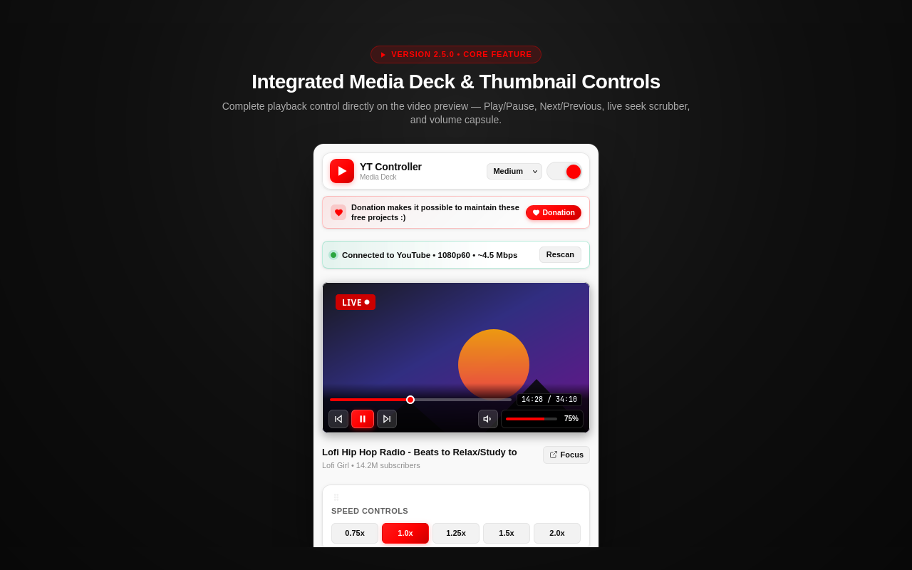
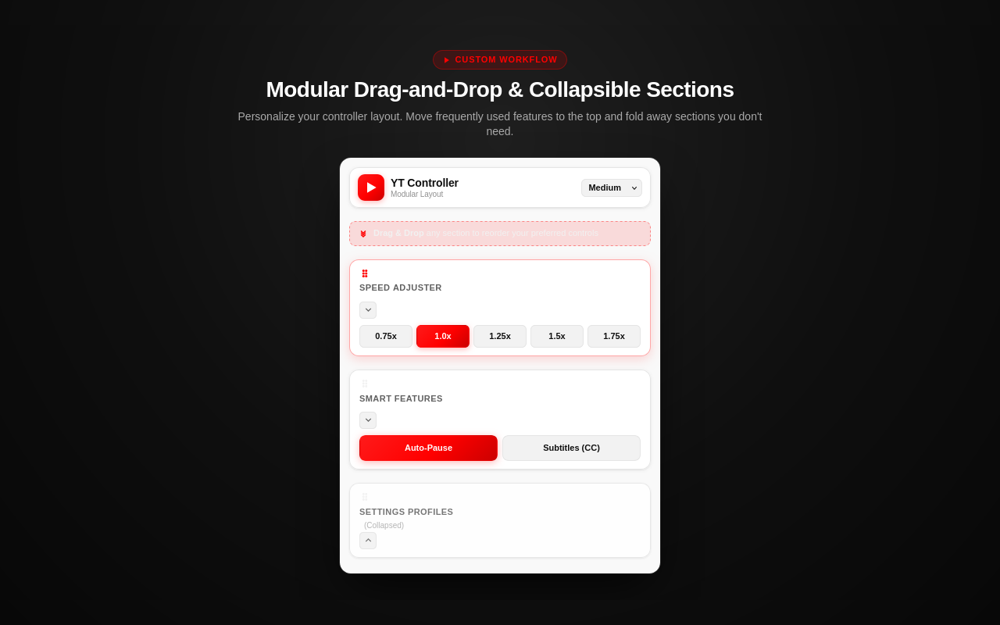
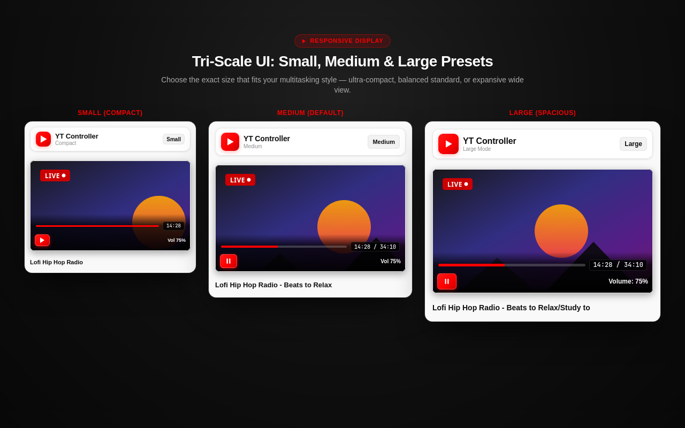
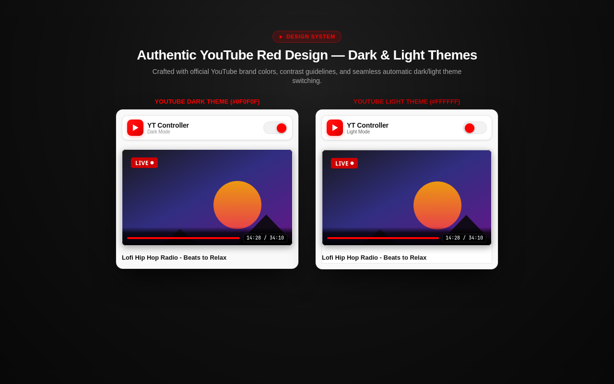
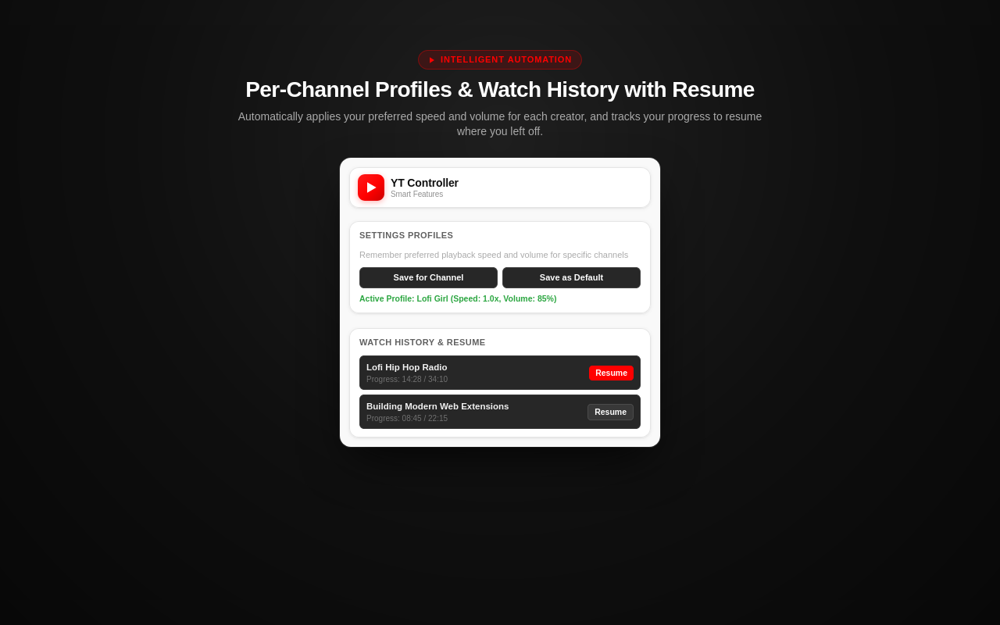
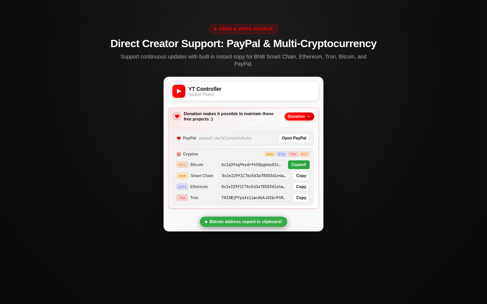

# YouTube Button Controller

Firefox extension for controlling YouTube playback from the popup and keyboard shortcuts.

[](https://www.gnu.org/licenses/gpl-3.0)
[](https://www.mozilla.org/firefox/)

## Current Version

2.5.0

## Screenshots

### Media Deck & Overlay Player
Live thumbnail preview card with interactive playback overlay, seekable progress bar, volume slider, and playback speed.



### Modular & Reorderable Cards
Drag-and-drop handles (`⠿`) to arrange sections to your liking, with one-click collapsible card toggles.



### Three UI Scale Presets
Compact, Standard, and Expanded display presets side-by-side to fit any screen resolution.



### Official YouTube Red Themes
Authentic YouTube Red dark and light themes with high-contrast playback controls.



### Profiles & Watch History
Per-channel playback presets and local watch history with one-click resume timestamps.



### Creator Support & Crypto Donations
Integrated support drawer supporting PayPal and multi-chain crypto (BNB, ETH, TRX, BTC) with one-click address copy.



## Features

- Top YouTube thumbnail overlay player with quick controls (Play/Pause, Prev, Next, Mute, Volume, Timecode)
- Live seekable progress bar with instant seekTo support
- Modular reorderable sections with drag-and-drop handles & persistence
- Collapsible modular sections with chevron indicators
- Tri-scale popup layout presets (Small / Medium / Large)
- Modern YouTube Red design system and copyright-safe vector SVG icons
- Floating toast status notifications
- Top donation support banner with expandable PayPal & Cryptos (BNB, ETH, TRX, BTC)
- Speed controls (0.25x - 2.0x, presets, +/- increments)
- Volume controls & mute toggle
- Auto-pause on tab switch
- Settings Profiles (channel-specific & global presets)
- Watch History + Resume
- Light / Dark theme toggle
- Help section & keyboard shortcuts modal
- Debug logs drawer

## Removed

- Theater Mode
- Pin Controller

## Install in Firefox

[Install from Firefox Add-ons](https://addons.mozilla.org/en-US/firefox/addon/youtube-button-controller/)

Or install locally for development:

1. Open Firefox and go to `about:debugging`
2. Click `This Firefox`
3. Click `Load Temporary Add-on`
4. Select `manifest.json`

## Test

1. Open a YouTube video.
2. Use the popup controls and keyboard shortcuts.
3. Switch tabs to confirm auto-pause.
4. Save and apply profiles from the popup.
5. Reopen the popup to confirm player-state sync.

## Debug Logs

Read logs:

```javascript
await browser.storage.local.get("ytControllerDebugLog")
```

Clear logs:

```javascript
await browser.storage.local.remove("ytControllerDebugLog")
```

## License

GPL-3.0
